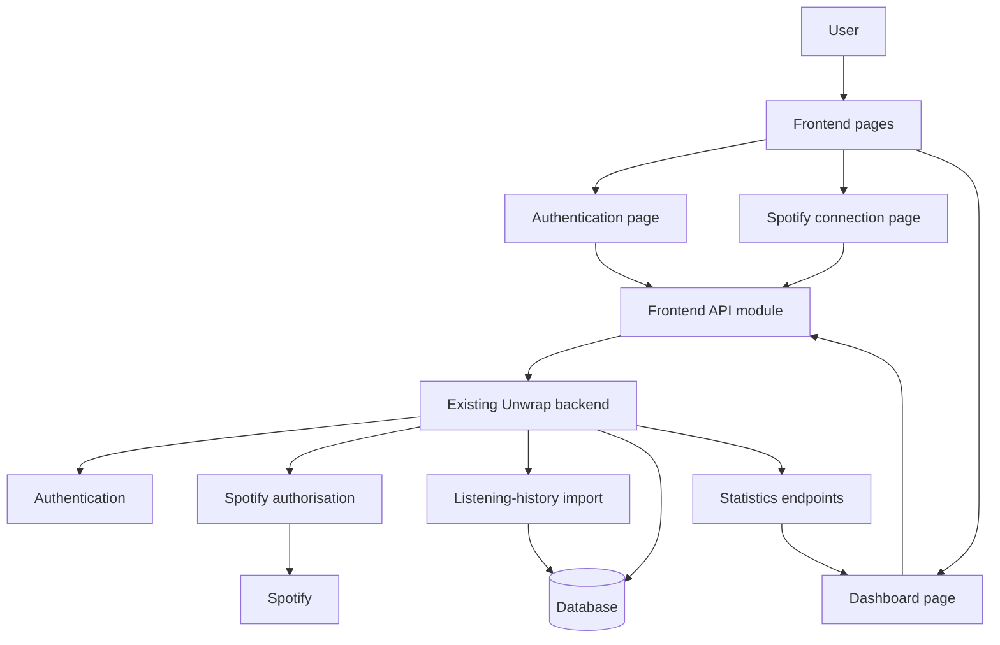

# Unwrap Frontend Technical Documentation

## Overview and scope

Unwrap is a website designed to help Spotify users explore their listening history and personal music statistics in more detail than Spotify Wrapped.

The wider group project began before this frontend work. The frontend and backend are kept in separate repositories. This document focuses on the frontend and explains how it connects to the existing backend. It does not claim ownership of the backend authentication, Spotify authorisation, database, or history-ingestion implementation.

The main frontend user journey is:
```text
Landing page
    -> account registration or login
    -> Spotify connection
    -> automatic history import
    -> statistics dashboard
```

### Repository links

Frontend repository: https://github.com/AlexD2006-dev/Unwrap-frontend  
Backend repository: https://github.com/AlexD2006-dev/Unwrap
Backend integration branch: https://github.com/AlexD2006-dev/Unwrap/tree/frontend-backend-integration

## Documentation audiences

This document is intended for:

- Developers or contributors who need to understand or run the frontend
- Assessors evaluating technical decisions and individual contribution
- Group members who need to understand the frontend/backend relationship
- Users or demonstrators who need a high-level explanation of the application

The Maya Thompson proto-persona is kept as a separate planning artifact. It represents assumptions about a typical regular Spotify listener rather than evidence from completed user research.

## Frontend architecture

The frontend uses separate HTML, CSS, and JavaScript files.

### Main pages

- `index.html` - landing page
- `about.html` - About page
- `auth.html` - registration and login
- `connect.html` - Spotify connection
- `dashboard.html` - listening statistics dashboard

### JavaScript responsibilities

- `app.js` handles landing-page navigation.
- `api.js` contains backend requests and demo responses.
- `auth.js` handles registration and login.
- `connect.js` handles Spotify connection behaviour.
- `dashboard.js` loads, renders, and refreshes dashboard statistics.
- `styles.css` contains shared styling.

This separation keeps page structure, presentation, API communication, and page-specific behaviour in separate areas of the project.

## Frontend/backend integration

The frontend is responsible for:

- Page structure
- Navigation
- Authentication forms
- Spotify connection interface
- API requests
- Dashboard rendering
- Loading, empty, and error states
- Demo-mode behaviour

The existing backend provides:

- Authentication
- Spotify authorisation
- Listening-history import
- Database access
- Statistics endpoints

The frontend expects the backend to be available locally at:
```text
http://127.0.0.1:3000
```

The frontend is normally served locally at:
```text
http://127.0.0.1:5500
```

The frontend should be opened through `127.0.0.1` rather than `localhost`, because the backend's local cross-origin configuration expects the `127.0.0.1` origin.

## Authentication and Spotify connection

The authentication page provides registration and login forms.

Registration:

1. Collects the user's email, display name, and password.
2. Sends the information to the existing backend.
3. Displays an error if registration fails.
4. Attempts automatic login after successful registration.
5. Redirects to the Spotify connection page after successful login.

Login:

1. Collects the user's email and password.
2. Sends the credentials to the existing backend.
3. Displays an error if login fails.
4. Redirects to the Spotify connection page after successful login.

The connection page redirects the user to the existing backend Spotify authorisation route. The frontend disables the button and displays status text to reduce repeated actions and make the redirect state clear.

The backend handles the real Spotify authorisation and history-import process. After that process completes, the user can reach the dashboard.

## Demo mode

The frontend includes an explicit demo mode activated through:
```text
?demo=true
```

For example:
```text
http://127.0.0.1:5500/index.html?demo=true
```

Demo mode:

- Uses controlled registration responses.
- Uses controlled login responses.
- Simulates Spotify connection.
- Displays controlled dashboard statistics.
- Does not require the real backend or Spotify OAuth service.

Demo mode is explicit rather than a silent fallback. This means that real backend failures are still shown instead of being replaced with fake data.

Demo mode also provides a way to test the frontend without having a Spotify account or access to the real Spotify authorisation flow.

## Dashboard and refresh behaviour

The dashboard displays:

- Top artists
- Top tracks
- Total listening time

When the dashboard opens, it asks `api.js` for the top artists, top tracks, and total listening time. These requests are independent, so `Promise.all()` waits for all three responses before the dashboard is updated.

The dashboard handles:

- Loading states
- Successful responses
- Empty artist results
- Empty track results
- Tracks without artist names
- Failed backend requests
- Refresh loading states
- Refresh success messages
- Refresh failure messages

The refresh button requests the latest statistics currently available from the backend. It does not trigger a new Spotify history import. If the backend data has not changed, the displayed statistics may remain the same.

## Architecture diagram


## Clean code and comments

The frontend follows these principles:

- Keep page structure, styling, API requests, and page behaviour separate.
- Keep functions focused on one main responsibility.
- Use names that describe purpose.
- Keep browser-dependent code separate from testable decisions where practical.
- Handle loading, empty, failed, and unexpected data states.
- Add comments only when they explain why a non-obvious decision exists.

Examples of useful comments include explanations of:

- Why demo mode is preserved during navigation
- Why the API request helper is shared
- Why a button is disabled during a redirect
- Why external API responses are mocked in tests
- Why refresh does not trigger a new history import

Obvious markup, loops, and straightforward DOM updates do not require comments.

## Problems and solutions

### Changing project scope

The frontend began as a smaller prototype with landing-page navigation, an About page, and sample dashboard content.

As the project developed, it expanded to include authentication, Spotify connection, backend requests, live dashboard statistics, demo mode, and refresh behaviour.

The documentation and tests were updated to describe the current project rather than keeping descriptions of the earlier prototype.

### Testing browser code

The frontend tests initially needed a browser-like environment because the code uses `document`, forms, events, and DOM updates.

Vitest was configured to use jsdom for this purpose.

Page-specific scripts also check whether expected elements exist before attaching event listeners. This allows the scripts to be imported safely in tests.

### Testing external services

Real Spotify and backend requests would make automated tests dependent on credentials, network availability, and external service behaviour.

The tests therefore use mocked API responses. This allows the frontend to be tested with successful, empty, failed, and network-error responses.

### Local origin mismatch

Opening the frontend through `localhost:5500` instead of `127.0.0.1:5500` caused a browser-level `Failed to fetch` error during local integration testing.

The issue was resolved by using the same local origin expected by the backend configuration:
```text
http://127.0.0.1:5500
```

### Keeping responsibilities clear

The frontend connects to existing backend functionality but does not claim to implement that backend functionality.

The documentation describes the frontend contribution and the integration boundary separately.

## Setup and contributor information

The practical setup instructions are available in the [contributor guide](CONTRIBUTING.md).

The contributor guide explains:

- Prerequisites
- Installation
- Running the frontend
- Running demo mode
- Running tests
- Internal development standards
- Reviewing Git changes
- Security rules
- Frontend/backend repository boundaries

## Individual contribution

This repository contains the individual frontend contribution to the wider Unwrap project.

The frontend contribution includes:

- Frontend page structure
- Shared styling
- Authentication screens
- Spotify connection interface
- Frontend API integration
- Dashboard rendering
- Loading, empty, and error states
- Dashboard refresh behaviour
- Demo mode
- Frontend automated tests
- Frontend documentation

The backend authentication, Spotify authorisation, database, and history-ingestion implementation belongs to the wider group project and separate backend repository.

## Limitations and future improvements

The complete real user journey depends on the separate backend and Spotify services.

The automated frontend tests use mocked responses, so they do not prove that real Spotify authorisation or a deployed backend will always succeed.

Spotify listening history belongs to the connected account. If several people share one account, the statistics may include listening data from all of them.

The refresh button retrieves the latest statistics already available from the backend. It does not import new Spotify history.

Future improvements could include:

- A configurable backend URL
- Date filtering
- More detailed listening history
- Additional visualisations
- Browser-based end-to-end tests
- More accessibility testing
- Usability testing with real users
- Continuous integration for automated test execution

## Related documentation

- [Testing documentation](testing.md)
- [Contributor guide](CONTRIBUTING.md)
- [Documentation planning and process](documentation-process.md)